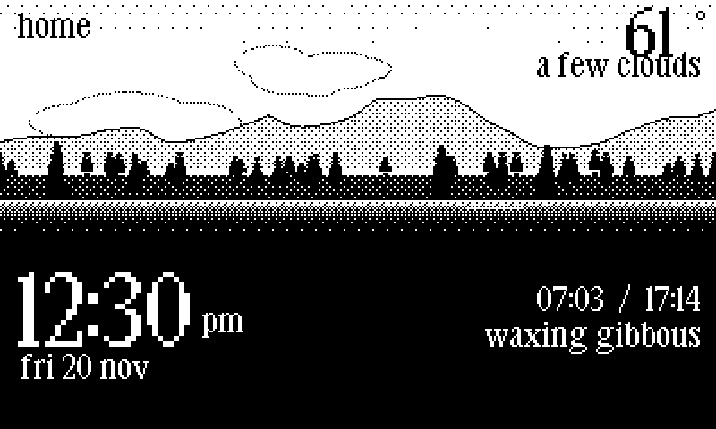
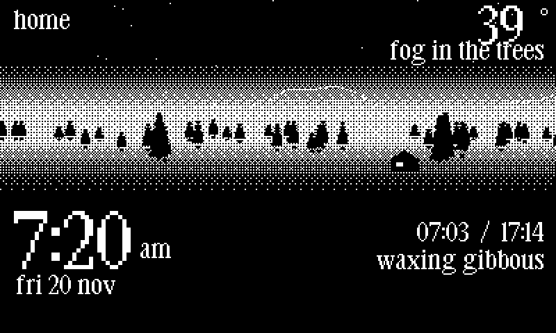
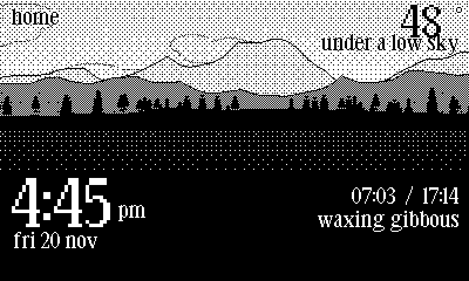
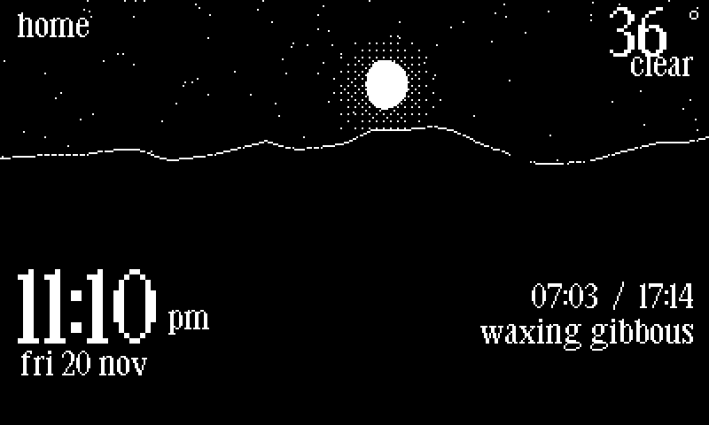
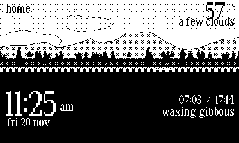

# Weather

An ambient weather window for the **Lapis** handheld's own screen: 400x240,
**1 bit per pixel**, reflective, no backlight. Not a web view — it opens a native
app window and pushes one-bit frames at the rate the display daemon asks for.

## What it does

**The sky follows the sun.** Solar altitude and azimuth are computed on-device
with NOAA's low-precision formulas, so dawn, midday, dusk and night drift by
themselves. The moon rides the same path, lagged by its phase, and is drawn as an
actual crescent or gibbous from the synodic month.

**The weather changes the picture.** Live conditions come from
[Open-Meteo](https://open-meteo.com) (no key, no account, no tracking): cloud
cover thins or thickens the sky, rain falls as slanted dashes that flip polarity
over dark and light ground, snow falls as single pixels, fog sits on the water,
and cold precipitation turns to snow whatever the icon says.

**The weather also chooses the view.** Snow brings you to the pines, fog to the
lake, thunder to the ridge, a clear night to the high ground, a low sky and wind
to the shore, a bright open day to the meadow. It only changes when the weather
does — checked every minute, agreed twice, never sooner than five minutes apart.
Pick a view by hand and it holds for twenty minutes.

**One-bit illustration.** Mountains and clouds get one-pixel contours so shapes
read at a glance; gradients become ordered dither with a little fixed grain; type
is stamped after the dither with a one-pixel halo. The clock and captions live on
a solid ink footer, so text never fights the landscape.

**Small details.** Snow settles on the ground and freezes the lake. A lighthouse
on the shore sweeps its beam after dark. A cabin window lights at night. Birds
cross now and then; the moon leaves a broken path on the water.

## Screenshots

| | |
|---|---|
|  |  |
| dawn, fog in the trees | noon, a few clouds |
|  |  |
| dusk, under a low sky | night, clear over the meadow |

## Controls

| | |
|---|---|
| **A** | next view |
| swipe left / right | previous / next view |
| tap the fingerprint sensor | hide the words, just the scenery |
| swipe up / down | a small card of details |
| **B** | back to the system |

## Running it

On a Lapis, with the device's own fonts and display daemon available:

    ./run.sh                  # start in the foreground
    ./run.sh --vista ridge    # start on a particular view
    ./run.sh --drift -6       # start six hours earlier (handy for previews)
    ./run.sh --preview out.png --scale 3   # one frame offline, no D-Bus

run.sh only puts the workspace numpy and the system Gio typelib on the path;
there is no build step and nothing to install.

To keep it running as a managed child:

    lapis background run --session-id <id> --description "Weather" -- sh ./run.sh

Location: copy config.example.json to config.json and set latitude, longitude and
place, or leave place as "home" and the app will ask ipwho.is once for a rough
location. Units are "imperial" or "metric".

## How it talks to the screen

The Lapis compositor (lapis-hwserviced) exposes an app-window manager. An app
creates a SOCK_SEQPACKET pair, hands one end to the daemon over D-Bus, and then
receives LPFW packets of 56-byte header plus 12 000 bytes of pixels (400x240,
1 bit, MSB first, 50-byte stride). Frames are pull-based: the daemon sends a
frame request, the app answers with a frame, the daemon reports presented or
dropped. The wire protocol is documented on the device at
/usr/share/lapis-hwserviced/app-window/protocol-v1.json.

## Layout

| file | role |
|---|---|
| weather.py | D-Bus window, wire protocol, input, weather-driven view choice |
| render.py | the painting: sky, ridges, trees, water, weather, type |
| fonts.py | reads the device's BMFont .fnt + .mono atlases |
| data.py | Open-Meteo, solar and lunar geometry, battery, config |
| preview.py | render a single frame to PNG without a display |
| make_previews.py | the stills and the looping GIF in screenshots/ |
| review.py | blur a one-bit frame into the grey a human actually perceives |
| cleanup.py | dev helper: stop stray instances |

## Notes

The renderer needs numpy; the window needs PyGObject (Gio) and the
lapis-display-client group, which the device's lapis user already has. The fonts
are the device's own assets and are read at runtime, not redistributed here.
